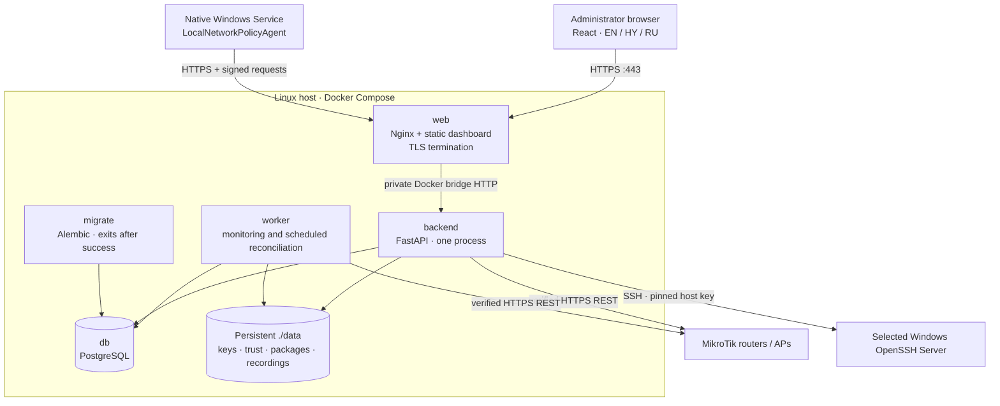
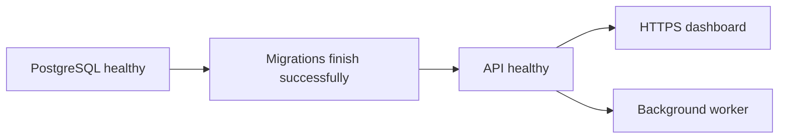

# Architecture

The control plane is a local modular monolith: FastAPI, PostgreSQL, a bounded database job worker, React/TypeScript, and an HTTPS reverse proxy. A separate .NET 10 Windows Service reconciles signed declarative policies. RouterOS REST uses verified TLS. No cloud services are needed at runtime.

Trust boundaries: browser → authenticated API; agent → certificate proof-of-possession API; backend → explicitly registered router; deployment repository → approved signed manifest → privileged installer; SSH broker → pinned endpoint host key. Policies cannot contain commands. Uploaded executable deployment and interactive SSH are separate, privileged, MFA-gated capabilities.

Device reports are claims, not independent proof. The compliance evaluator owns the check catalog; missing, stale, wrong-version, or wrong-source evidence is UNKNOWN. Network controls require evidence collected by the router connector. A new policy invalidates prior compliance. Developer devices always have UNVERIFIED endpoint state.

Router changes use immutable previews containing before-state hashes, device ownership tags, encrypted snapshots, approval, serialization, readback and a durable outcome. RouterOS is not transactional. Partial failure is ERROR and requires reconciliation; never report success after a transport error. Production writes default off. A lease is not authorization, and gateway filtering is not Layer 2 isolation.

Existing Windows installations start in audit mode. No policy path deletes accounts, formats drives, or shrinks partitions. Storage assessment and backup/migration approval are separate workflows. The installed service uses SYSTEM with administrator/SYSTEM-only files; standard users cannot modify it. Local administrators and offline attackers remain outside that guarantee.

Low Resource Mode uses one API process, one worker, bounded queues/transfers, paginated queries, content-addressed packages, resumable transfer, and shorter telemetry retention. Security deadlines still apply. Events carry revision identifiers rather than full inventory.

See progress.md for the precise implementation and verification ledger. Unimplemented or hardware-unverified controls must never be presented as operational security guarantees.

## Runtime layout

Only `web` publishes a host port. PostgreSQL and FastAPI are reachable on the private Docker bridge. The current bridge traffic is not separately TLS encrypted; the host, Docker daemon and container network are inside the server trust boundary. Do not run unrelated untrusted containers on that network.

The browser never talks directly to RouterOS. It cannot obtain router passwords, package execution keys, or device private keys. The agent stores its non-exportable machine private key on Windows; only its certificate and fingerprint are stored by the server.

## Startup dependencies

`migrate` is a one-shot service; an exited status of zero is expected. Other services use `restart: unless-stopped`. Health checks report readiness; Docker Engine does not automatically restart a running container merely because its health becomes unhealthy. Investigate unhealthy services through logs before restarting them.

## Independent security states

A device has a compliance `state`, a `network_state`, a management `mode`, and an `enabled` identity flag. They answer different questions:

| Field | Example | Meaning |
|---|---|---|
| `state` | `UNVERIFIED` | The endpoint's current mandatory requirements are not all verified |
| `network_state` | `QUARANTINE_PENDING` | Network restriction has been requested but not verified |
| `mode` | `AUDIT` | The agent may inspect and report, without applying remediation |
| `enabled` | `false` | Device authentication is revoked; router authorization still needs reconciliation |

Never derive one of these fields solely from another. In particular, revoking a certificate does not remove a manually configured Wi-Fi credential.

## Design decisions

| Decision | Reason | Tradeoff |
|---|---|---|
| Modular monolith and one worker | Modest RAM/CPU, simpler backups and offline deployment | Large installations will need measurement before scaling |
| PostgreSQL-backed jobs | Avoid Redis and additional infrastructure | Database locking and job transitions need careful tests |
| Signed requests over HTTPS | Device proof of private-key possession without trusting proxy identity headers | Clock synchronization and replay storage are required; this is not transport-level mTLS |
| Exact signed payload bytes | Python and C# verify the same bytes | Do not decode and reserialize before verifying |
| Audit-first enrollment | Preserve existing accounts, storage and firewall configuration | Compliance may remain unknown until a reviewed migration is completed |
| Explicit unsupported capabilities | Avoid treating menu existence as proof of PPSK/VLAN/isolation support | More hardware-specific adapters and lab tests are still needed |

See [code map](developers/code-map.md) for implementation entry points and [data and jobs](developers/data-and-jobs.md) for transaction boundaries.
