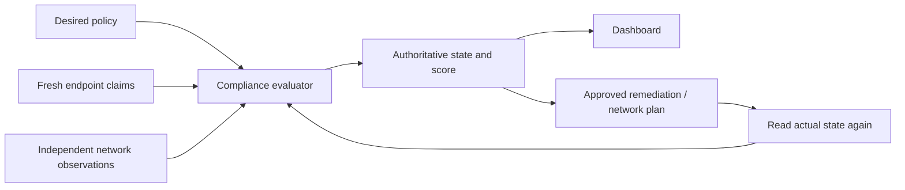

# Developer guide

This guide explains the current implementation, including the parts that intentionally remain unverified. Start with the walkthrough if the project is new to you; use the code map when changing a specific component.

Diagrams use Mermaid blocks, which render in compatible Markdown viewers. Each diagram has a nearby text explanation so the guide remains usable in a plain editor.

| Question | Read |
|---|---|
| What runs where? | [Architecture](../architecture.md) |
| What happens when a PC joins? | [One device, end to end](walkthrough.md) |
| Which file should I change? | [Code map](code-map.md) |
| How are requests authenticated and signed? | [Protocols](protocols.md) |
| How do policies, checks and exceptions work? | [Policy and compliance reference](../policy-reference.md) |
| How do installs and SSH differ from policies? | [Privileged operations](privileged-operations.md) |
| How do jobs survive failure? | [Data, jobs and recovery](data-and-jobs.md) |
| How do I implement a feature and test it? | [Contribution recipes](contributing.md) |
| What tests need Windows or MikroTik? | [Validation and lab testing](testing.md) |
| How can Codex avoid rediscovering everything? | [Project skills](codex-skills.md) |
| What is unfinished? | [Implementation ledger](../progress.md) |

## The five ideas to learn first

1. **Desired state and actual state are different.** A policy is what should be true. Evidence describes what was observed. Executing an operation does not itself establish compliance.
2. **Endpoint and network trust are different.** A device signs requests with its private key. It still cannot supply trusted network-side evidence about its own isolation.
3. **A preview is a durable object.** Router changes are saved with their baseline hash and generation. Approval applies that specific preview rather than regenerating arbitrary commands.
4. **Policies contain configuration, not commands.** Software installation and interactive SSH use separate authenticated workflows because they can run privileged code.
5. **An unknown result stays visible.** Missing, expired, unsupported, or incorrectly sourced evidence becomes `UNKNOWN`. It must not become `PASS` merely to make the dashboard look healthy.

For example, `firewall.enabled = PASS` and eighteen unknown checks does not mean a computer is secure. A green installation exit code also does not establish that a required driver is effective after reboot. These distinctions are part of the data model and API, not merely documentation advice.

## A practical first hour

Run the backend tests, read [the walkthrough](walkthrough.md), then inspect `backend/app/compliance/engine.py` and its tests. Next, follow one endpoint from its decorator in `backend/app/api/` into its service function and database records. Finally, build the dashboard and Windows Service. None of these steps needs production router credentials.
