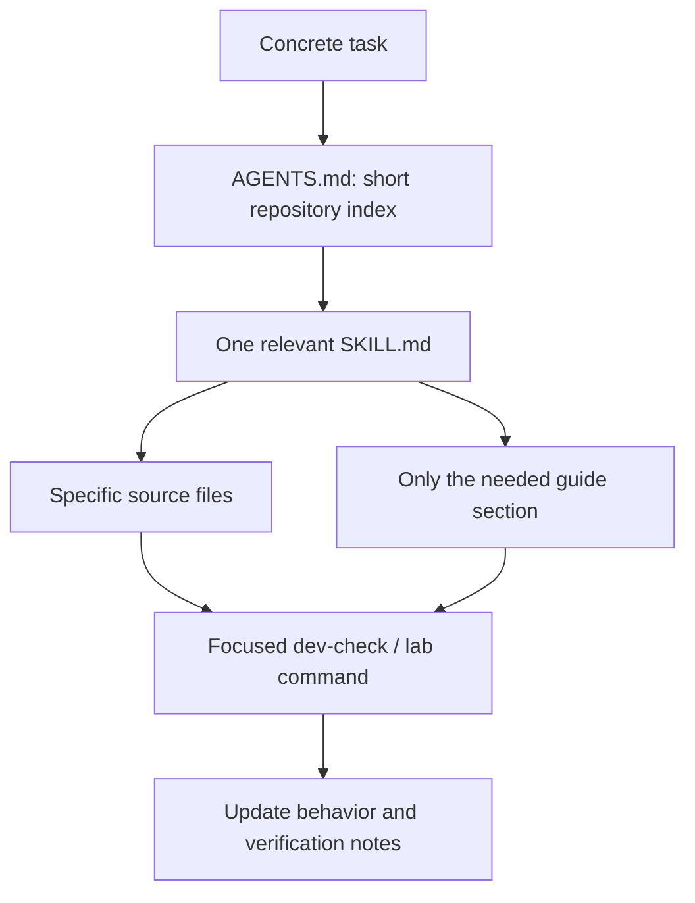

# Project-specific Codex skills

The repository includes three short skills that point to maintained source maps and detailed references. They reduce repeated repository discovery and avoid loading unrelated platform instructions for a small task. They do not guarantee a particular token or runtime reduction.

| Skill | Use it for | Example request |
|---|---|---|
| [lantern-development](../../.agents/skills/lantern-development/SKILL.md) | FastAPI, policy/compliance, React, translations and developer docs | `Use $lantern-development to add a compliance check and its evidence tests.` |
| [lantern-windows](../../.agents/skills/lantern-windows/SKILL.md) | Windows Service, signed protocol, maintenance scripts, MSI and updates | `Use $lantern-windows to diagnose enrollment after service restart.` |
| [lantern-infrastructure](../../.agents/skills/lantern-infrastructure/SKILL.md) | Compose, offline deployment, recovery, RouterOS and lab validation | `Use $lantern-infrastructure to validate a legacy wireless discovery adapter.` |

Claude Code reads the same skills through symlinks in `.claude/skills/` and the shared instructions through `CLAUDE.md`, which imports `AGENTS.md`. `.claude/settings.json` denies reading secrets and running host-network changes. Edit only the originals in `.agents/skills/`.

## How the context is organized



Detailed instructions live in the developer docs. Skills keep only non-obvious boundaries, entry points, command selection and references. This prevents several long, slightly different copies of the same architecture from drifting apart.

## Install in a user's Codex skill directory

The tracked source is `.agents/skills/`. To expose the same directories in the user's configured Codex skill location:

```sh
python3 scripts/install-project-skills.py
```

The default target is `$CODEX_HOME/skills`, or `~/.codex/skills` when `CODEX_HOME` is unset. The installer creates symlinks back to this checkout, so updates here remain available without maintaining copied skill content. It refuses to replace a same-named unrelated skill. On a platform without symlink support, use repository discovery or an administrator-managed copy instead.

For an isolated test target:

```sh
python3 scripts/install-project-skills.py --target /tmp/lantern-skill-test
```

Skill availability in a running client depends on its discovery/refresh lifecycle. The files do not change the current conversation's advertised skill catalog automatically. Start a new session or use the client's supported refresh mechanism if they are not listed.

## What the helpers do

| Helper | Purpose | Side effects |
|---|---|---|
| `dev-check.py --area ...` | Runs the relevant existing tests/builds | Test/build artifacts only; no deployment or router access |
| `check_docs.py` | Checks local Markdown targets and skill entrypoints | Reads repository files |
| `install-project-skills.py` | Exposes the tracked skills in a selected directory | Creates new symlinks; preserves unrelated entries |
| `lab.py prepare/build/up/smoke/down` | Validates the Docker application in a fixed test project | Test images, temporary keys/config, isolated containers/database |

These helpers do not download private credentials or authorize production mutations. The original task's authorization and environment permissions still control those actions.

## Maintain the skills

When a source file moves or a workflow changes, update the code map and the affected skill link. Keep the descriptions specific enough to avoid selecting a Windows skill for an unrelated frontend change. Do not add generic programming tutorials, full external manuals, historical logs, or per-task progress transcripts to a skill.

Run the local documentation check. If the system skill-creator validator is available, also run its `quick_validate.py` on each `.agents/skills/lantern-*` directory. Neither check proves that hardware behavior is correct.
