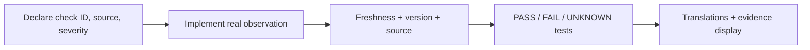

# Development workflow and change recipes

## Local tools

Use Python 3.11 or newer, Node 24, the .NET 10 SDK, Docker Engine and a recent Docker Compose plugin. Production always runs through Compose; using a host virtual environment is only a development/test convenience.

```sh
uv venv .venv
uv pip install --python .venv/bin/python -r backend/requirements.txt pytest pytest-asyncio
cd frontend
npm ci
cd ..
```

The package lock and pinned Python requirements make repeated installs predictable. Change the dependency input and lock together. Do not install new dependencies just to edit documentation.

Run one relevant check set:

```sh
python3 scripts/dev-check.py --area backend
python3 scripts/dev-check.py --area frontend
python3 scripts/dev-check.py --area agent
python3 scripts/dev-check.py --area docs
```

If `dotnet` is not on PATH, use `--dotnet /absolute/path/to/dotnet` or `DOTNET_BIN`. The helper does not download tools, invoke Docker deployment, contact routers, or modify endpoint configuration.

## Add a backend endpoint

1. Put request validation and the route in the appropriate `backend/app/api/` module. Existing modules are mounted automatically by the explicit list in `main.py`; add a new module there if necessary.
2. Require the correct human permission or `agent_identity`. An endpoint should not accept either identity interchangeably.
3. Put nontrivial reusable behavior in a service. Keep external side effects explicit.
4. Use the injected session and a transaction. Add an audit record for mutations without storing secrets.
5. Return stable error codes through `HTTPException`; do not return raw exception strings containing credentials or SQL.
6. Test unauthenticated access, wrong role, invalid input, success and material failure behavior.

Use `/api/docs` to inspect the actual generated schema. Device actions must not return verified success merely because a job was queued.

## Add a database field

Change the SQLAlchemy model, create a new Alembic revision against an isolated development database, and review the generated operations. Add defaults or backfills before making a field non-nullable on existing data.

```sh
# In backend/, using a development-only DATABASE_URL and ENCRYPTION_KEY:
../.venv/bin/alembic revision --autogenerate -m "describe the change"
../.venv/bin/alembic upgrade head
```

Never point autogeneration experiments at production. Do not rewrite an applied migration. Run the migration round-trip test, and use PostgreSQL for locking/constraint behavior that SQLite cannot model.

## Add a compliance check



Start in `policies/schema.py::CATALOG`. Define what observed evidence is sufficient; do not make the new check pass from desired policy or an operation's return code.

For agent checks, update `Monitoring/Inspect.ps1` and its Windows validation procedure. For network checks, implement a server-side connector/probe observation; never allow `/agent/compliance` to assert it.

Test missing evidence, stale evidence, future timestamps, wrong source, wrong policy version, a genuine failure and a genuine pass. A mandatory unknown must prevent 100%. Update English, Armenian and Russian labels and [the check ownership table](../policy-reference.md).

## Add a policy control or layer behavior

Update `PolicyDocument`, then the merge/relaxation rules, server compilation, agent schema validation, and actual inspection/remediation as applicable. The server and C# allowlists must evolve together. Every field also needs a visual control and translations; follow [adding a setting](policy-editor.md#adding-a-setting).

Do not add a field to the schema and describe enforcement as implemented if no collector or actuator uses it. Test version invalidation and any restriction relaxation. Scope changes should compile into a new immutable assigned version.

## Add an agent operation

Choose the correct subsystem first:

| Operation | Subsystem |
|---|---|
| Repeated safe desired-state correction | Declarative policy allowlist |
| Approved application/driver/update execution | Deployment |
| Explicit locale, SSH, firewall migration or reboot | Typed maintenance |
| Interactive diagnosis | SSH |
| Partition resizing/formatting | Separate migration workflow; currently unavailable |

Use bundled fixed scripts or known executable handlers. Pass typed arguments; do not concatenate administrator input into PowerShell expressions. Preserve a durable execution marker for operations that must not replay after a crash.

Add Windows VM validation for actual behavior. Cross-compilation and signature tests cannot establish service ACLs, firewall behavior, installer rollback or disk safety.

## Add a RouterOS capability

Keep transport separate from planning. Probe the actual menu with verified HTTPS and distinguish unsupported commands from authentication errors or network failure. Record the discovered version/packages/model, but do not infer advanced PPSK or VLAN support from the menu name alone.

Create fixtures for the relevant stack and expected unsupported/error responses. A write path must preserve manual entries, use an ownership tag, reject stale previews, save a before-state and verify readback. Add packet-path tests in CHR/physical labs when the change claims network protection.

## Add a dashboard interaction

Use `api()` for requests and `useData()` for revision-triggered reads. Fetch real data and display pending/unknown states. Add locale keys to all three catalogs and keep user-entered names as Unicode data rather than translating them.

For a substantial new page, place the component under `frontend/src/pages/` and reuse the existing shell, form and table patterns. Confirm with the server API which permissions and approval fields the action actually needs. A visual confirmation does not substitute for server authorization.

The current locale test checks matching key sets, nonempty values and Unicode; it does not prove that every dynamic error or technical label has been translated. Manually inspect all three languages and add targeted UI tests as coverage grows.

## Keep handoff notes useful

Update [progress](../progress.md) with four distinct facts: implemented code, automated validation, simulation, and hardware verification. Include exact commands for a new workflow and document actual limitations. Do not replace concrete findings with a generic claim of production readiness.

## Suro feature routes

For owners, overlapping groups, AP batches, incidents, topology and the user-session helper, use [the illustrated extension guide](suro-expansion.md). Keep new modules readable; `frontend` includes Prettier as a development dependency (`npx prettier --write path/to/changed.tsx`). Python modules use conventional multi-line formatting. Format the changed files rather than producing unrelated repository-wide formatting diffs. Re-run the relevant focused checks after behavioral changes.

Preserve existing state identifiers during Suro branding work. MFA defaults to optional username/password login. New UI fields need all three translations and an exact contextual-help mapping; use Armenian as the initial locale and keep a valid saved language preference. Before a privileged form submits, check that empty/unchanged inputs do not inadvertently enable a radio, clear a host key, or overwrite an unrelated setting.
