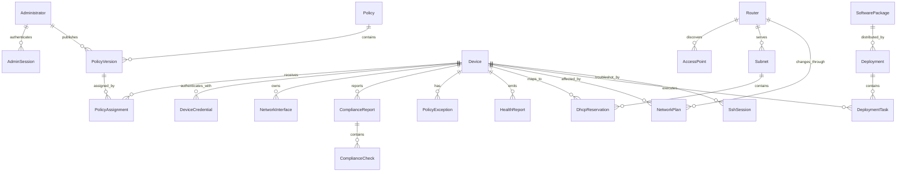
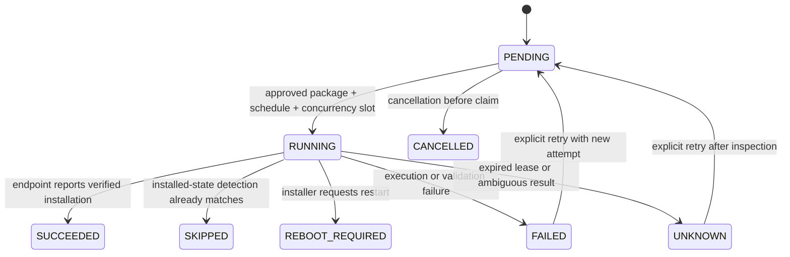
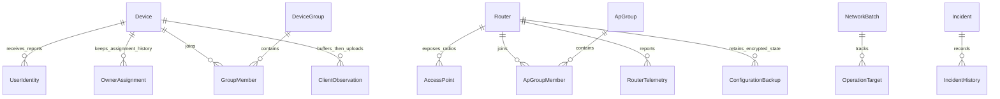

# Data model, jobs and failure recovery

## Relationships

This diagram shows the main relationships, not every column. See `backend/app/models/__init__.py` for the full model and Alembic for the production schema.

## Record families

| Family | Records | Purpose |
|---|---|---|
| Human access | Administrator, Role, AdminSession | Password/MFA identity, permissions and browser sessions |
| Endpoint identity | Device, NetworkInterface, Enrollment, DeviceCredential, RequestNonce | Persistent inventory, enrollment and replay protection |
| Policy | Policy, PolicyVersion, PolicyAssignment, PolicyOverride, PolicyException | Desired-state history and approved variations |
| Measurement | ComplianceReport, ComplianceCheck, HealthReport | Time-bound observations and evaluation output |
| Network | Router, AccessPoint, Subnet, DhcpReservation, NetworkAccessRule, NetworkPlan, QuarantineState | Discovery, addressing and requested/verified network changes |
| Operations | BackgroundJob, RemediationResult, MigrationAssessment | Typed work and outcomes |
| Distribution | Upload, SoftwarePackage, Deployment, DeploymentTask | Offline artifact and per-device installation lifecycle |
| Troubleshooting | SshTarget, SshSession | Pinned SSH destinations and session authorization |
| Accountability | Alert, AuditLog | Findings, acknowledgment and mutation history |

Some model families prepare for broader workflows than currently implemented. A table's existence does not establish that every intended automation path is operational.

## Transaction boundaries

Ordinary API calls use `db_session`: success commits, exceptions roll back. Integrity errors become conflicts without returning SQL details. Multi-record actions should remain inside that transaction unless an external side effect requires a durable intermediate state.

Router changes are the important exception. PostgreSQL cannot roll back a RouterOS API request:

```mermaid
stateDiagram-v2
    [*] --> PREVIEW
    PREVIEW --> APPLYING: claim router generation + lock; commit
    APPLYING --> APPLYING: persist backup and each applied operation
    APPLYING --> VERIFIED: all operations read back correctly
    APPLYING --> ERROR: transport, ownership, baseline or readback failure
    VERIFIED --> [*]
    ERROR --> [*]: operator reconciliation required
```

The plan's `VERIFIED` state means configuration readback, not proof of endpoint isolation. The encrypted before-state is retained in the result. Automatic snapshot restoration is avoided because it could overwrite an administrator's concurrent change. A complete inverse-plan rollback facility is still pending.

Router locks have a deadline and are renewed while operations progress. Generation checks reject stale previews. A failure after applying one operation can leave that operation on the router; the saved `applied` list is therefore essential for recovery.

## Deployment tasks

`SUCCEEDED` is endpoint-verified installation evidence, not independent network assurance. A lost network response after installation is not permission to rerun an installer.

## Upload consistency

Files and database rows do not share one transaction manager. Chunk writes are flushed before the database offset advances. A retry writes at the committed offset and truncates trailing bytes, allowing recovery from a file write that succeeded before a database rollback.

Completion checks the entire SHA-256 and publishes with a non-overwriting content-addressed link. A process failure can still leave temporary files or unreferenced objects. Automatic repository garbage collection and full crash-injection tests remain work to do; do not delete objects merely because an in-progress transaction has not referenced them yet.

## Time and freshness

Database timestamps use UTC stored without a timezone offset; external timestamps must be interpreted as UTC. Browser display formatting may use a selected locale, which is presentation only.

The evaluator checks evidence lifetime, version binding, source and future-clock tolerance. The worker expires stale heartbeats, but read endpoints also defend against stale `COMPLIANT` display if the worker has stopped. There are remaining inconsistencies between per-policy timing and server-wide display timing, documented in [policy reference](../policy-reference.md).

## Outage behavior

| Failure | Current behavior | Recovery |
|---|---|---|
| Agent cannot reach server | Retry with exponential backoff and jitter; existing applied state remains | Restore HTTPS/time/DNS and reconcile; do not fabricate a new success report |
| Server restarts | Worker waits a warm-up deadline before automatic enforcement | Require fresh router observations and device evidence |
| Router unavailable | Record unavailability and avoid claiming enforcement | Restore management access, rediscover and review partial plans |
| Router plan interrupted | Plan may remain `APPLYING`; partial operations may exist | Inspect saved plan and actual router state before retrying |
| Installer response lost | Lease eventually becomes `UNKNOWN` | Inspect software state and execution ledger, then approve retry if appropriate |
| Maintenance task interrupted | Durable local started marker avoids replay | Manual investigation; full server-side recovery is incomplete |
| Browser disconnects | Server remains authoritative; SSH broker closes disconnected session | Reauthenticate and request a new SSH session |

## Retention and resource limits

The worker currently removes expired nonces/sessions, health rows older than the configured seven-day default, and compliance reports/checks older than 30 days. Security audit logs are excluded from automatic deletion.

Package objects, completed upload files, terminal recordings and local deployment ledgers need an operator retention policy; complete automatic cleanup is not implemented. Monitor storage headroom before large deployments.

The Compose limits total 896 MiB for long-running containers by default, plus a transient 192 MiB migration container. These are configured ceilings, not measured idle usage or a guarantee that the entire Linux host fits in 1 GiB. Leave room for the OS, filesystem cache, Docker and image building. [Monitoring](../monitoring.md) gives commands.

## Suro ownership and infrastructure records

`Router` is a physical infrastructure device; `AccessPoint` is a discovered radio/interface. An AP group therefore joins `Router`, preserving the original radio table and API. `NetworkBatch.kind` separates infrastructure work from endpoint requests; each target has its own state. The worker's durable infrastructure lease serializes batches while software deployment retains its existing independent task leases. A waiting reboot never becomes successful just because a request returned.

`SystemSetting` stores approved monitoring budgets. Short-lived health and client observations expire; owner assignment history, incident investigation and administrator security audit are not automatically erased by telemetry retention. Encrypted configuration backups may contain Wi-Fi credentials and must be retained only within protected storage. See [the Suro workflow guide](suro-expansion.md) for state transitions, conflict resolution and recovery gates.
