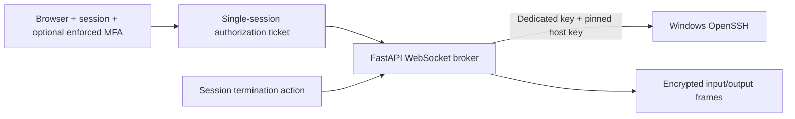

# Software deployment, maintenance and SSH

These operations are intentionally separate from policy reconciliation. A policy says which configuration should exist. An installer, a signed administrative script, or an SSH session can execute privileged code and therefore needs its own authorization, audit trail and lifecycle.

## Offline software deployment

```mermaid
sequenceDiagram
    participant Admin
    participant API
    participant Store as Content-addressed files
    participant DB
    participant Agent
    Admin->>API: Start upload (metadata, size, hash)
    API->>DB: Upload record + offset
    loop Bounded chunks
        Admin->>API: PUT exact offset + bytes
        API->>Store: Write and fsync
        API->>DB: Advance committed offset
    end
    Admin->>API: Complete upload
    API->>Store: Verify SHA-256; publish object
    Admin->>API: Approve package, then create deployment
    API->>DB: Deployment + per-device tasks
    Agent->>API: Claim next eligible task
    API->>DB: Enforce concurrency; lease task
    API-->>Agent: Signed device-bound manifest
    Agent->>API: Authenticated ranged download
    Agent->>Agent: Verify hash, publisher, architecture, build
    Agent->>Agent: Check detection rule; execute typed installer
    Agent->>API: Progress outcome, exit code, verification result
```

The repository deduplicates identical bytes by SHA-256, not by filename. Two different files named `setup.exe` are separate objects. Approval is a trust decision by an administrator; upload completion is not malware analysis or publisher validation on Linux.

### Supported handlers and limits

| Kind | Handler | What to verify before rollout |
|---|---|---|
| `msi` | `msiexec`, silent/no automatic restart | Correct product code and version/update behavior |
| `exe` | Approved installer with explicit argument array | Vendor silent options, uninstall semantics and detection |
| `msix` | Online package provisioning | Provisioning is not installation into every existing user profile; typed removal remains limited |
| `driver` | Approved CAB, expand, `pnputil` | Archive/catalog signing, actual hardware match, post-reboot device state |
| `windows_update` | `wusa` or DISM | Build applicability, dependencies and reboot/readback |
| `language_pack` | DISM package install | Exact Windows build/edition and offline resource availability |
| `feature` | DISM with local source and `/LimitAccess` | Source structure and compatibility for that feature |
| `script` | Approved Authenticode-signed `.ps1` | Administrator trust, parameter validation and independent result detection |
| `agent_update` | External scheduled MSI task | Pinned agent publisher; post-restart version verification |

Current uploads accept a single package object. A bare `.inf` depends on its catalog and driver files; upload a reviewed signed bundle rather than expecting a lone INF to be sufficient. Direct multi-file driver/source bundles and complete application-specific detection plugins are unfinished.

The MSI path detects existing product registration without querying `Win32_Product`, which can cause repair side effects. For other installers, unsupported result detection deliberately produces `UNKNOWN` instead of claiming success from exit code zero.

### Concurrency and retries

All targets can receive tasks at once, but only the configured number are leased as `RUNNING`. The PostgreSQL scheduler uses an advisory transaction lock while counting and claiming work. Each device also receives only one running deployment.

An installation lease lasts two hours. An expired lease becomes `UNKNOWN`, because an offline device may have installed the software before losing contact. Retrying requires a new explicit administrative action. The agent keeps a durable per-task/per-attempt ledger to avoid blindly replaying a started operation.

Cancellation prevents pending work and is checked before installation. A running installer is allowed to finish safely; the system does not promise that arbitrary installers can be killed or rolled back. Codes such as `3010` are reported as `REBOOT_REQUIRED` rather than silently rebooting a user.

## Typed maintenance jobs

The current maintenance API supports only these operations:

```text
windows.locale
ssh.enable
firewall.apply_allowlist
system.reboot
```

A device must be in `MAINTENANCE` or `APPROVED_REMEDIATION`, have a policy assignment, and receive a signed device-bound job. There is no generic command field. `MaintenanceRunner.cs` maps each operation to one bundled script.

- **Locale:** Requires installed language resources. It schedules the signed user-preference script in the intended standard user's context at logon, preserving other configured languages. `PENDING_USER_LOGON` is not completion verification.
- **OpenSSH:** Requires the Windows capability to be installed from an appropriate offline source. It validates keys, preserves configuration backups, tests `sshd_config`, protects key files and limits the managed inbound rule to management addresses. Existing broader rules require review.
- **Firewall:** Requires explicit management-server allowances, refuses unrelated enabled outbound allow rules, exports the firewall, registers a separate recovery task, applies the managed configuration and verifies HTTPS reachability before cancelling recovery.
- **Reboot:** Requires a scheduled approved job and refuses a detected interactive user. It schedules a reboot without a force-close flag. Test remote/disconnected-session handling on your Windows builds before relying on it.

Maintenance result records remain endpoint reports. The next inventory/compliance cycle must verify the effective state. Automated expiry/recovery for all maintenance-job failure modes is still incomplete.

## Browser-based SSH



An administrator configures a dedicated SSH target with an independently verified host public key. Its IP must match a verified reservation and an allowed management subnet. The private key is encrypted on the server and is never sent to the browser.

An eligible device must be managed, enabled, recently reporting and have a valid enrolled identity. The current broker allows at most two authorized/active sessions, a 30-minute session duration, a five-minute input idle timeout and a 4 MiB recording cap. A watchdog observes logout, session termination, administrator disablement and device revocation.

Opening SSH does not edit router quarantine rules. Restricted devices need an explicitly authorized maintenance path already permitted by the network. A maintenance authorization does not prove the route exists and must not silently open one.

### What terminal auditing can and cannot establish

Recordings contain encrypted terminal input/output frames, including timestamps and direction. They can include credentials typed by an administrator and sensitive command output, so access must be restricted.

They are not a complete record of commands executed by subprocesses, actions outside the session, file transfers, terminal control sequences, or host-side tampering. Host auditing and centralized protected log export are separate deployment decisions. The database audit trail is not append-only or tamper-proof against a database administrator.
