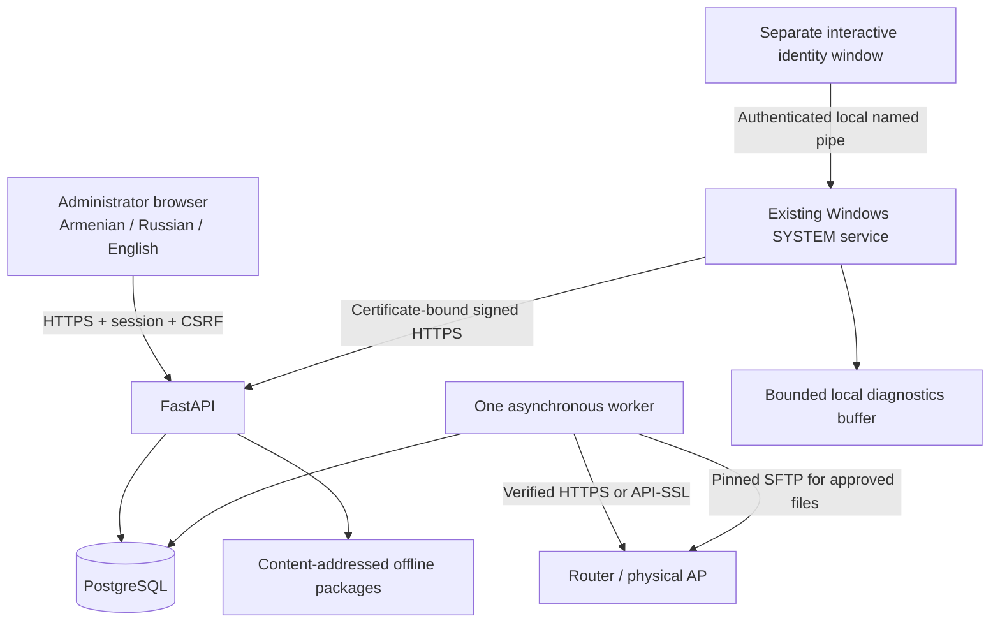
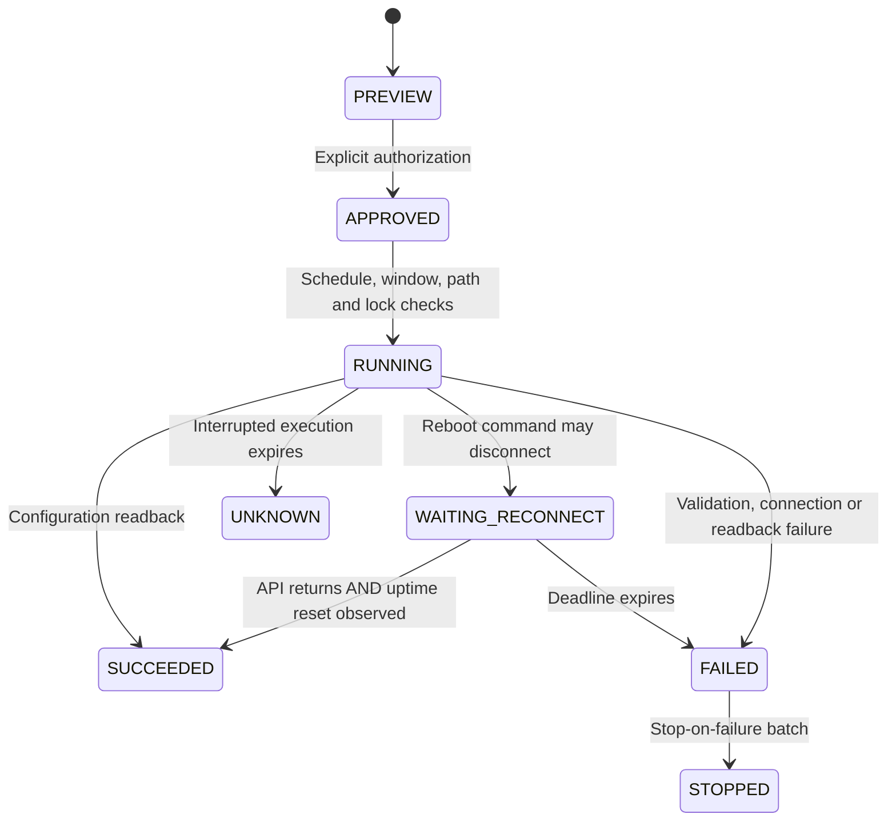

# How the Suro extension works

Read this guide when changing owners, groups, network monitoring, AP operations, recovery, or contextual help. The original [code map](code-map.md) remains the shortest route to a particular function. [Progress](../progress.md) records the difference between executable code, simulated tests, and hardware evidence.

## One server, separate responsibilities

Suro remains a modular monolith. Docker Compose starts PostgreSQL, a migration job, an API, one worker, and an HTTPS dashboard proxy. The API and worker share the same Python image and database. There is no new monitoring database, message broker, AI service, or second Windows agent.



The worker does not trust a Windows report as proof of network isolation. Router association observations show that a MAC was seen; they do not establish cryptographic identity or complete Layer 2 containment. Compliance still uses the existing strict source, policy-version, and freshness gates.

## Names that deliberately remain unchanged

The displayed product name is Suro. Existing installations retain the Compose project `lantern`, image repositories `lantern-backend` / `lantern-web`, `LANTERN_TAG`, database names, cookie `lantern_session`, and browser preference `lantern-language`. The Windows namespace, CNG identity name, `%ProgramData%\Lantern`, installation directory `Lantern Policy Agent`, and service `LocalNetworkPolicyAgent` also remain compatible. Router ownership comments continue to use `lantern:`.

Changing these names cosmetically could select an empty database volume, create a second service, lose a key, or stop recognizing a managed rule. Do not rename them in a refactoring without an explicit state migration and rollback procedure. Existing certificates and signing keys are never rotated by rebranding.

Migration `fae1ac5dc81c` adds records and columns; it does not rewrite old device identifiers, credentials, revisions, or policy assignments. Existing physical infrastructure is conservatively classified as `ROUTER` until an administrator reviews its role. It is never silently made eligible for automatic AP recovery.

## Owner is different from current user

An assigned owner is an administrative decision. An interactive account and a person's self-reported name are observations. They are stored separately.

```mermaid
sequenceDiagram
    participant U as Interactive Windows user
    participant H as SuroIdentity.exe
    participant S as Existing service
    participant A as Server API
    participant D as Administrator
    U->>H: Log in; first-use prompt defaults to Armenian
    H->>S: status over local named pipe
    S->>S: Read message, impersonate client, obtain real SID/account
    S-->>H: Already submitted or pending
    U->>H: Full name; optional rank / no rank
    H->>S: submit
    S->>S: Validate and save protected per-SID outbox
    S->>A: Signed identity upload; retry if offline
    A->>A: Store USER_REPORTED, never assign owner automatically
    D->>A: Review, correct, assign owner, optionally verify
    A->>A: Assignment history + administrator audit
```

The UI cannot choose another account's SID. The service obtains it from the pipe's impersonated Windows token after reading a message. The helper checks that the pipe server PID matches the running `LocalNetworkPolicyAgent` in the Service Control Manager, using read-only status rights. It does not require a standard user to query a SYSTEM process token. This protects against ordinary local impersonation; a local administrator is outside this assurance boundary.

The identity UI runs in the user's session through an HKLM Run entry, not Session 0. It closes without prompting when that SID already submitted information. Submission is saved before acknowledgment and uploaded on a later service cycle. An installation without a logged-in user stays pending. The UI executable is readable/executable by Users; agent state and private credentials in ProgramData remain restricted to SYSTEM/Administrators. Validate both new installs and direct MSI upgrades in Windows VMs.

`UserIdentity` stores SID-bound reports and their review status. `OwnerAssignment` stores changes to the assigned owner. A later report must not overwrite an approved owner. CSV exports require management permission, are audited, use UTF-8 with BOM, and neutralize spreadsheet formula prefixes.

## Two types of groups

`DeviceGroup` / `GroupMember` contain Windows endpoints. `ApGroup` / `ApGroupMember` contain physical `Router` records. The older `AccessPoint` table represents discovered wireless interfaces; it is not a second physical AP inventory.

Membership is many-to-many. Deleting a group deletes membership and scoped policy layers, not the endpoints, routers, files, or manually configured network rules. AP templates are desired configuration, not instructions to overwrite a whole device. Conflicting templates for a shared AP block a template operation.

Device policies resolve global, class, group, then explicit device controls. Conflicting values at the same group tier raise `policy.group_conflict`; an administrator must resolve the control with an explicit device layer or adjust the groups. Relaxations still need explicit approved-relaxation authorization. Assignment/membership changes recompile and invalidate old evidence. An older passing report cannot certify a new effective version.

Group software deployment reuses existing `SoftwarePackage` objects and task leases. The same SHA-256 file is stored once regardless of how many groups use it. Group operations record a durable batch plus target outcomes. `QUEUED` and `DELIVERED` mean request acceptance/delivery, not verified endpoint success.

## An AP operation is a state machine



The API saves fresh baseline values, an immutable preview, target compatibility, router generation, and connectivity impact. Approval expires after ten minutes. Execution checks write gates and the current generation, claims a per-router lease, reads the relevant fields again, and saves an encrypted backup before mutation. Only fixed operations and fields are accepted. There is no raw command endpoint.

A protected AP or management gateway needs its exact name and confirmed independent recovery access. This is checked again during execution. The worker claims a database lease for infrastructure batches. Default batch size is one, and the next reboot target waits for verification. A router already restarting cannot count as an available alternative path. An arbitrary responding router also cannot count: the operator must declare independent path IDs or explicitly confirm separate recovery access. Stop-on-failure defaults to true.

The automatic path is narrower: disabled globally and per AP by default, explicitly reviewed ACCESS_POINT role, no protected gateway, a fresh reachable API, configured independent management path, corroborating sustained critical resource measurements or opt-in restoration of a radio explicitly approved as enabled, cooldown, daily attempt budget, and normally an active maintenance window. Shared/upstream failures block recovery. Repeated failures disable that AP's recovery and create an incident. An unreachable API cannot reboot itself.

A responding API does not prove a reboot. Verification compares returned uptime with the pre-command observation and elapsed time; upgrades also require the expected version. An interrupted command is recorded as uncertain and is not replayed blindly. Cancelling a batch stops new work, while verification of already issued work continues.

Full safe-mode transactions are not available through the current REST/API abstraction. Suro uses narrow changes, durable baselines, readback, failure stops, and reviewed inverse changes. Binary restore and package upgrades additionally require a pinned SSH host key, compatible metadata, and a separately approved recovery workflow. Binary restores require known matching serial number and RouterOS version. The first upgrade implementation permits newer releases within the same major version; major transitions/downgrades require manual vendor-guided review.

## Observations, incidents, and topology

`RouterTelemetry` contains bounded health, interface counters, associated clients, and newly seen log entries. Missing sensors are null, never zero or invented values. Short polls collect resource/association information; full inventory is less frequent. API concurrency is capped. Unavailable routers are polled less frequently. Native API-SSL responses and SFTP transfers have explicit bounds/timeouts.

Windows uses native WLAN APIs for SSID/BSSID and signal quality. It stores at most 120 observations and approximately 1 MiB locally. The service uploads at most 100 per request after reconnection. The API rejects observations outside its bounded time window and deduplicates sequences. It stores event identifiers and network metadata, not personal files or credentials.

`diagnostics.correlate` reads bounded time windows. Rules compare AP client counts, resets, health, DHCP leases, interface errors, and Windows disconnection/reachability observations. A common infrastructure outage becomes one primary incident linked to affected devices. Stable deduplication keys update the existing incident. Every cause is explicitly probable and has a confidence label. A lack of new observations does not automatically resolve an incident.

Topology separates observed management reachability/association from administrator-defined membership/subnet/VLAN relationships. Physical uplinks and unmeasured VLAN packet paths remain unknown. A drawn management line does not claim physical cabling or proven isolation. The SVG is lightweight and selectable, with group/subnet/health filters.

## Translation and help workflow

Default language is `hy`; a valid saved preference remains respected. Dashboard labels use `src/locales/{hy,ru,en}.json`. Contextual prose lives in `src/help/v1/{hy,ru,en}.json` under stable article IDs. `HelpButton` opens the exact native article; `HelpCenter` searches that language's titles and body. Do not copy English text into another locale to satisfy key-count checks.

For a new feature: add the label in all three catalogs, write practical help in all three article files, map its field/action to the appropriate ID in `help/catalog.ts`, and add a visible question-mark button. Tests exercise Armenian default login, native help rendering/search, and complete catalog structure. Technical diagnostics may retain original RouterOS field names inside evidence JSON.

## Focused validation

```sh
python3 scripts/dev-check.py --area backend
python3 scripts/dev-check.py --area frontend
DOTNET_BIN=/path/to/dotnet python3 scripts/dev-check.py --area agent
python3 scripts/dev-check.py --area docs
python3 scripts/lab.py prepare
python3 scripts/lab.py build
python3 scripts/lab.py up
python3 scripts/lab.py smoke
python3 scripts/lab.py down
```

The lab uses only localhost:18443 and test credentials. Backend tests include migration preservation, strict evidence, owner separation, policy conflicts, batch safety, API failures, native framing, correlation, and resource settings. Windows cross-builds and cryptographic contracts do not validate actual service sessions, ACLs, MSI installation, WLAN events, or router firmware. Use the [VM/CHR matrix](testing.md) before enabling writes on real infrastructure.

The service-status authentication uses [Microsoft’s documented service access rights](https://learn.microsoft.com/en-us/windows/win32/services/service-security-and-access-rights) and [QueryServiceStatusEx](https://learn.microsoft.com/en-us/windows/win32/api/winsvc/nf-winsvc-queryservicestatusex). MSI directory ACLs use [WiX PermissionEx SDDL](https://docs.firegiant.com/wix/schema/wxs/permissionex/). These API contracts still need standard-user VM execution tests.

## Recovery continuation: authorization and retained labs

Recovery conditions live in the existing per-router JSON policy, so this extension needs no schema migration. `resource_pressure` retains the previous behavior; `unexpected_radio_disabled` is separately enabled. The latter requires at least three sustained network observations, an explicitly enabled desired state and the detected wireless stack. It changes only `disabled=false`, uses the same baseline/backup/readback path, and takes priority over a full reboot. Shared AP or gateway resource pressure blocks speculative resource reboots.

Queued automatic targets recheck global/per-router enablement, current permitted conditions, maintenance windows and shared/upstream trouble. Independent management paths must still be permitted by the current recovery policy. Disabling recovery stops unissued work; verification continues for a reboot already issued. AP metadata editing now requires approval permission because role, protected status and SSH host-key pins are security decisions.

The fixed localhost lab retains its PostgreSQL volume across shutdown. Its matching encryption/signing keys and environment must also survive. `lab.py prepare` now refuses to generate keys if retained lab volumes exist without matching configuration, and refuses key generation when Docker cannot inspect storage. Restore the environment and data together from the same backup. Never point fresh keys at a retained database or delete the volume merely to make a smoke test run.
