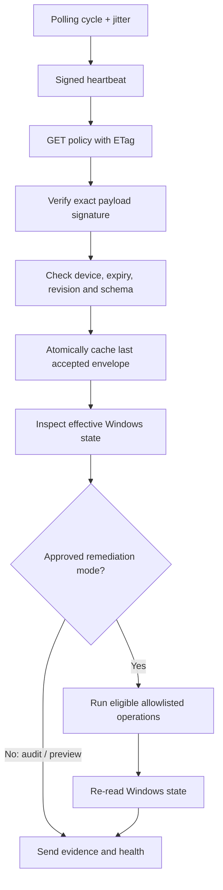

# One computer, end to end

This example uses `PC-001`, a standard Windows device. It follows real handlers and records so you can debug the same flow in code. No step requires changing a production router.

## 1. An administrator prepares the device

In the dashboard, register the hostname and primary Wi-Fi MAC. `POST /api/v1/devices` creates a `Device` with an internal UUID, `PENDING_ENROLLMENT`, and `AUDIT` mode. MAC normalization means `00-11-22-33-44-55` and `001122334455` cannot become separate devices.

Create and publish a policy, then assign its version to this device. Publication needs the `approve` permission; recent MFA is checked when explicitly enabled. Registration alone does not assign a policy. The agent waits if it has no assignment, so do this before expecting a complete inventory report.

Generate a 15-minute enrollment token from the device page. The database keeps its SHA-256 hash rather than the plaintext token. Transfer the token, server address, trusted policy public key, MAC and code-signing publisher pin through the protected provisioning file described in [enrollment](../enrollment.md).

## 2. Windows establishes an identity

```mermaid
sequenceDiagram
    participant Admin as Administrator
    participant Win as Installer / Windows
    participant API as FastAPI
    participant DB as PostgreSQL
    Admin->>API: Register device; request token
    API->>DB: Device + token hash + expiry
    Admin->>Win: Protected provisioning file + signed MSI
    Win->>Win: Create non-exportable CNG machine key and CSR
    Win->>API: POST /agent/enroll (token, CSR, MAC)
    API->>DB: Validate binding; save CSR
    API-->>Win: 202 PENDING_APPROVAL
    Admin->>API: Approve the CSR fingerprint
    Win->>API: Retry same token and CSR
    API->>DB: Save certificate and fingerprint
    API-->>Win: Device UUID and issued certificate
    Win->>Win: Store certificate with machine key; remove local token
```

The token is not a replacement for approval. The MAC binds the request to the intended inventory entry but is not trusted as cryptographic identity. The certificate proves possession of the enrolled private key on later requests.

Retries preserve the same CSR. A reused token with a different CSR is rejected. An administrator must revoke an old identity before replacing it with a different key.

**Debug here:** `api/agent.py::enroll`, the `Enrollment` and `DeviceCredential` rows, Windows Event Log, and `%ProgramData%\Lantern\agent.jsonl`. Never copy a token or private key into an issue.

## 3. The service synchronizes a signed policy

The service runs without an interactive login. Each cycle sends a signed heartbeat, then requests `/agent/policy` with its cached ETag. If nothing changed, the server can return `304`; otherwise it signs an envelope containing the device UUID, version UUID, revision, mode, expiry and declarative document.



In Audit Mode, an existing `ExistingAdmin` account, existing D: partition, and custom firewall rules are inventoried. They are not deleted or replaced. Missing desired accounts and firewall conflicts become evidence to review.

The service caches a policy but does not perform new remediation when it cannot complete the current synchronization. A server outage leaves the already applied Windows configuration in place. Do not interpret this as complete offline autonomous reconciliation.

**Debug here:** `PolicyWorker.cs::Reconcile`, `SignedDocument.cs`, `Monitoring/Inspect.ps1`, and the assigned versus reported policy UUIDs.

## 4. The server evaluates evidence

The server owns the list of checks. It does not trust the agent to define a shorter list. Agent evidence is stamped at arrival with the assigned policy version and source `agent`. Attempts to submit `network.*` evidence through the agent endpoint are rejected.

Suppose the machine reports a healthy D: partition but the router has not been discovered:

| Check | Observation | Result |
|---|---|---|
| `disk.d.valid` | D: exists, healthy NTFS | `PASS` |
| `account.user.not_administrator` | User is a standard user | `PASS` |
| `network.ip_reservation.valid` | No independent lease observation | `UNKNOWN` |
| `network.isolation.valid` | No validated topology evidence | `UNKNOWN` |

The device cannot be `COMPLIANT` or score 100%. Unknown network checks remain unknown even if the agent says it applied everything successfully. The current connector does not yet produce full isolation/internet evidence; see [the ledger](../progress.md).

**Debug here:** `compliance/engine.py::evaluate`, `services/devices.py::reassess`, `ComplianceReport`, and `ComplianceCheck`.

## 5. A router reservation is reviewed

Read-only discovery imports the router snapshot and probes the installed wireless stacks. An approved allocation profile declares the subnet, DHCP server, exclusively managed address range and exclusions.

The allocator excludes known leases, router addresses, ARP observations, dynamic pools, registered reservations and explicit exclusions. A new reservation creates a `NetworkPlan` preview. Applying it checks that the baseline configuration still matches, writes the minimal managed entry, and reads it back.

An existing manual static lease can be imported without rewriting it. An existing dynamic lease that would need conversion is refused for manual review in this implementation. A lease is addressing information; separate authorization is still necessary.

**Debug here:** `mikrotik/planner.py`, `create_lease_preview`, the plan generation/hash, and `services/network.py::execute_plan`.

## 6. Something changes

There are three common paths:

- **A new policy is published:** assignment moves to a new immutable version and compliance is invalidated immediately. Old evidence does not verify the new version.
- **The agent stops reporting:** freshness deadlines make the endpoint unverified. The worker distinguishes a fresh network observation from an assumption about whether the machine is powered on.
- **A mandatory check fails:** safe remediation may run in an approved mode. Network enforcement additionally requires infrastructure readiness, write gates, fresh observations, a policy opt-in and any configured grace period.

Current automatic wireless rejection is narrower than complete quarantine: it does not establish wired or shared-Layer-2 isolation, and may remove remediation connectivity. The dashboard therefore uses `RESTRICTION_APPLIED_VERIFICATION_REQUIRED` after configuration readback.

## 7. The dashboard updates

The backend SSE stream sends revision markers. The browser refreshes affected page queries; it does not receive a full stream of health history. A device detail page keeps the authoritative state, numerical score, check details, policy assignment and network state separate.

For an unmanaged developer device, enrollment and endpoint inspection are skipped. It remains `UNVERIFIED / UNMANAGED`, with no endpoint compliance percentage. Registering its MAC can create a DHCP preview while preserving existing Wi-Fi credentials.
