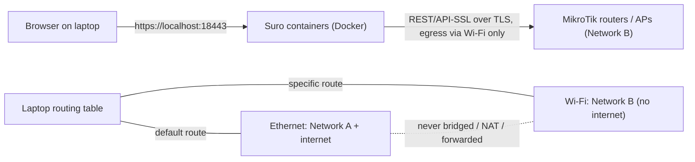

# Developing on a laptop connected to two networks

The development laptop runs Suro and opens its dashboard while it is connected to:

- **Network A** (Ethernet): internet access for tools and packages.
- **Network B** (Wi-Fi): the live isolated network with real computers, MikroTik routers and APs.

Network B is production. Its connectivity and access lists must stay as they are. Suro never changes the laptop's networking. Every step below that would change it is marked **manual, needs your approval** and is optional.



## 1. Identify the adapters (read-only)

Linux (the current development OS):

```sh
ip -br addr                 # interface names and addresses
ip route                    # default route must use the Ethernet interface
nmcli device status         # which connection each adapter uses (read-only)
python3 scripts/netcheck.py --target 192.168.88.1   # replace with a real router IP
```

Windows (if a developer uses Windows):

```powershell
Get-NetIPConfiguration
Get-NetRoute -DestinationPrefix 0.0.0.0/0
Find-NetRoute -RemoteIPAddress 192.168.88.1   # shows the interface Windows would use
```

`scripts/netcheck.py` only reads `ip -j addr/route`, `/proc/sys/net/ipv4/ip_forward` and `tailscale debug prefs`. It exits with status 1 and a `CRITICAL` line when:

- `ROUTER_ALLOWED_NETWORKS` overlaps the internet uplink subnet. Example: the code default `10.0.0.0/8` contains an Ethernet address of `10.20.30.40/16`.
- A router address would leave through the Ethernet default gateway. This is what happens when Wi-Fi is disconnected, or when Network B uses subnets the laptop has no route to.
- Tailscale advertises routes or uses an exit node.

Do not register or contact a router while the check reports `CRITICAL`. Router TLS verification stops Suro from sending credentials to an impostor that answers on the wrong network. The check stops the attempt before that point.

### Routing facts to confirm before any discovery

1. The Ethernet connection holds the only default route. If the Wi-Fi DHCP gives a default route with a lower metric, internet traffic tries to use Network B.
2. Each management subnet on Network B is reached through the Wi-Fi interface. The laptop only knows the Wi-Fi subnet it was assigned. Other VLANs or subnets behind the Network B gateway are unreachable unless that DHCP server pushes routes. Do not assume Network B is a single subnet: list the subnets from the gateway router's `ip/address` and DHCP networks after the first read-only discovery.
3. IPv4 forwarding is on whenever Docker runs. Docker sets the `FORWARD` chain policy to `DROP`, which keeps the networks apart. Check with `sudo iptables -S FORWARD`. Never add `MASQUERADE` or `ACCEPT` rules between the two interfaces, and never enable Internet Connection Sharing on Windows.

**Manual, needs your approval** (not done by Suro or by agents; each is reversible):

- Keep the Wi-Fi connection from becoming the default route or changing DNS:
  `nmcli connection modify "<WIFI_CONNECTION>" ipv4.never-default yes ipv4.ignore-auto-dns yes`
  Undo with `... ipv4.never-default no ipv4.ignore-auto-dns no`.
- Reach an additional Network B subnet through the Wi-Fi gateway:
  `sudo ip route add <SUBNET/PREFIX> via <WIFI_GATEWAY> dev <WIFI_IF>`
  This does not survive a reboot. Remove it with `sudo ip route del <SUBNET/PREFIX>`.

## 2. Start Suro on the laptop

`make help` lists all commands. The development path is `make install`, `make netcheck TARGET=<router IP>`, `make lab`, `make lab-admin`, `make check` and `make lab-down`. The same steps are shown below as raw commands.

The isolated Docker lab binds only to `127.0.0.1:18443`, so neither network can reach the dashboard:

```sh
python3 scripts/lab.py prepare     # test-only keys/config in /tmp/lantern-lab.env and /tmp/lantern-lab-data
python3 scripts/lab.py build
python3 scripts/lab.py up
```

After joining the MikroTik Wi-Fi, run `make lab-use-wifi`. It reads the Wi-Fi interface's own subnet and gateway, refuses if the subnet overlaps the Ethernet uplink, writes only that subnet to `ROUTER_ALLOWED_NETWORKS` in the lab config, and runs `netcheck` against the gateway. Routers on other subnets behind that gateway must be added by hand, comma-separated. To set it manually instead, edit `/tmp/lantern-lab.env`. It is mode 600 and test-only, so never commit it.

```ini
OPERATION_MODE=read_only
ROUTER_ALLOWED_NETWORKS=192.168.88.0/24     # exact Network B management subnet(s) only
```

Run `python3 scripts/lab.py down` and then `up` to apply the change. Create the administrator:

```sh
docker compose -p lantern-lab --env-file /tmp/lantern-lab.env -f compose.yaml \
  -f infrastructure/docker/compose.lab.yaml exec backend python -m app.cli create-admin --username admin
```

Open `https://localhost:18443` and trust the lab certificate from `/tmp/lantern-lab-data/tls/server.crt` for this browser only. A banner under the top bar shows the active safety mode.

Windows test computers on Network B cannot reach a loopback-only server. For agent tests, run the normal Compose installation with `LAN_BIND_IP` set to the laptop's **Wi-Fi** address. Never use `0.0.0.0`, which would also publish the dashboard on the internet LAN. Compose now falls back to `127.0.0.1` when `LAN_BIND_IP` is missing.

## 3. Safety modes

| `OPERATION_MODE` | Routers | Windows endpoints | Use |
|---|---|---|---|
| `read_only` | Discovery, health and inventory only. Every write is refused in the transport, in batch approval, by recovery and by the worker | Deployments and maintenance are not handed out. Agents receive a signed `AUDIT` mode | First contact with Network B |
| `dry_run` | Applying a plan returns `DRY_RUN` with the exact operations and sends nothing. The plan stays a preview | Same as `read_only` | Review what a change would do |
| `controlled_test` | Writes only to routers in `TEST_ROUTERS` (ID, name or management IP) whose per-router write switch is on | Changes only to `TEST_DEVICES` (ID or hostname). Other agents audit | Pilot on designated equipment |
| `production` | Writes to routers whose per-router write switch is on, after preview, approval and readback | Normal device modes | After a successful pilot and explicit approval |

Enforcement lives in `backend/app/services/safety.py`. Every RouterOS adapter is wrapped in `GuardedRouter`, so a background job or another API route cannot bypass it. Only `ping`, `interface/monitor-traffic` and `file/read` count as read commands. SFTP (backup, restore, upgrade) counts as a write. If `OPERATION_MODE` is unset, the legacy `ROUTER_WRITES_ENABLED` decides (`false` means `read_only`) and endpoint behavior stays as before.

## 4. First real-world test: read-only discovery

1. Confirm `OPERATION_MODE=read_only` (shown in the banner) and that `netcheck.py --target <router IP>` reports `OK`.
2. On the router, create a **read-only** RouterOS account for Suro (see [MikroTik integration](../mikrotik-integration.md#minimal-routeros-accounts)). Creating that account is a router change you make yourself through your existing administration path. Suro does not do it.
3. Register the router in **Access points** with its literal management IP and CA file. Run discovery.
4. Open **Network → Network inventory**. It merges DHCP leases, ARP entries and Wi-Fi registrations that the routers already reported. Suro sends nothing to endpoints. Classify printers, phones and infrastructure there. Labels are notes only.
5. Compare the result with WinBox. Nothing on the router changes. The audit log shows only discovery and label entries.

Devices that are asleep, have static addresses outside DHCP, sit behind other routers or are isolated as wireless clients may be missing. A randomized (locally administered) MAC is flagged and is not proof of identity.

## 5. Tests and shutdown

```sh
python3 scripts/dev-check.py --area backend      # uses fake routers only
python3 scripts/dev-check.py --area frontend
python3 scripts/lab.py smoke                     # isolated HTTPS/PostgreSQL smoke
python3 scripts/lab.py down                      # stops the lab, keeps its volume
```

Shutting down Suro changes nothing on Network B. If you made any manual route or NetworkManager change, undo it with the commands above.

## Needs your explicit approval

- Any `controlled_test` or `production` operation on real equipment: name the routers or devices, the exact preview, the backup and the rollback first.
- Any change to the laptop's routes, NetworkManager profiles, firewall or VPN.
- Creating RouterOS accounts, changing `/ip service` or importing certificates on routers.
