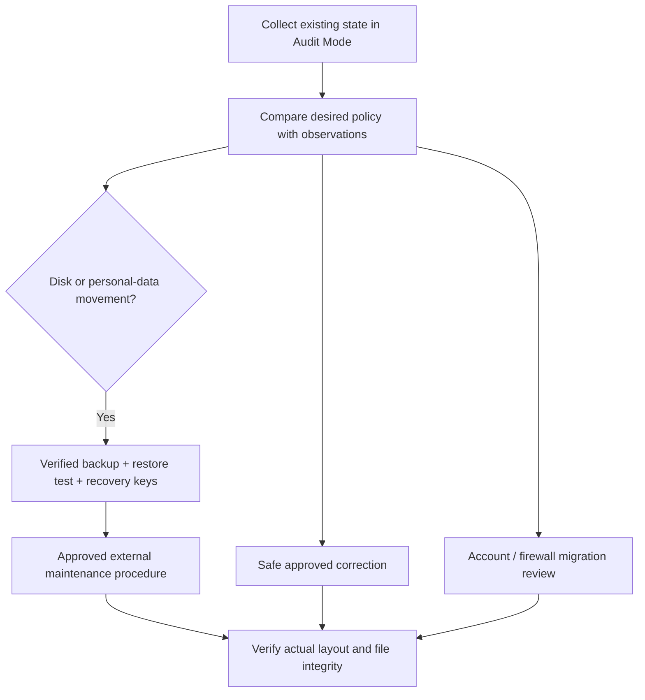

# Safely importing existing computers

## Start with observation

Use Audit Mode for every existing computer. Install/enroll the service, assign a baseline policy, collect inventory and inspect the individual checks. Existing human accounts, profiles, data, recovery partitions and manual firewall rules must remain intact.

The agent inventories local users/memberships, visible and hidden partitions, volumes, BitLocker metadata where available, effective firewall profiles/rules, network adapters and OS information. Some user-folder data is unavailable when its registry hive is unloaded; that is unknown evidence rather than permission to guess.

## Assessment workflow

The current `/devices/{id}/migration-assessment` route returns current users/volumes/firewall metadata, safe actions, approval-required actions, blockers, risk and backup requirements. It records the inventory hash used for that report.

## Current storage boundary

**No destructive storage executor is available in this release.** The assessment explicitly returns `destructive_execution_available=false`. A missing D: volume produces `MANUAL_INTERVENTION_REQUIRED`. The system does not shrink, move, delete or format partitions, and does not automatically move personal folders.

This boundary is deliberate. A future executor must verify disk identity/layout, supported shrink limits, filesystem health, free space, encryption/recovery material, backup restore evidence, approved folder scope, ACLs and copied-file integrity. It must not treat a checkbox as proof that a usable backup exists.

Use a separately approved Windows maintenance procedure and re-inventory afterward. Preserve EFI, recovery, OEM and BitLocker-required partitions. Test the procedure on a clone/VM with a recovery console before applying it to important data.

## Account migration

Review unexpected accounts and administrator memberships with the owner of the machine. The standard user must not remain an administrator, but the system must first establish a working approved recovery administrator.

`Provision-ApprovedAccounts.ps1` is an explicit local administrative tool that prompts for secure passwords when accounts need creation. Policy does not contain administrative passwords, and no onboarding path deletes old human accounts. Profile/data transfer and account retirement still need an approved migration plan.

## Firewall migration

Inspect enabled effective outbound allow rules and Group Policy conflicts. The allowlist maintenance script refuses unrelated enabled allow rules rather than deleting them. Prepare an approved conflict-resolution plan first.

Retain management HTTPS, DHCP and required local infrastructure traffic for both IP versions. Export the existing firewall and test the recovery task. A successful management probe is necessary but does not establish every allowed/blocked traffic requirement; verify packet paths independently.

## Finish only after readback

Collect fresh inventory after any maintenance. Check the current policy version, effective users/groups, actual folder locations, volume health, firewall rules and independent network observations. Execution reports alone do not close a migration or establish compliance.
