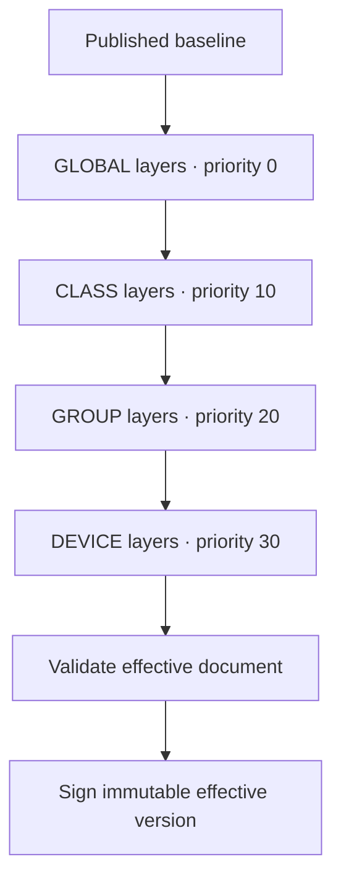

# Policy and compliance reference

## A policy is declarative configuration

`PolicyDocument` in `backend/app/policies/schema.py` validates every published document. Unknown fields are rejected. There is no command, script body or shell-execution field.

Administrators edit policies visually (Policies → a policy → Settings); the JSON below is what the editor stores. See the [visual policy editor](developers/policy-editor.md) for drafts, preview, assignment, the enforcement status of every setting, and which settings reach older agents.

Example audit baseline:

```json
{
  "schema_version": 1,
  "admin_account": "admin",
  "user_account": "user",
  "approved_admins": ["admin"],
  "require_d": true,
  "hide_c": false,
  "firewall_allowances": [
    {"remote": "192.168.88.10/32", "protocol": "TCP", "ports": [443]}
  ],
  "heartbeat_seconds": 120,
  "heartbeat_deadline_seconds": 300,
  "evidence_ttl_seconds": 300,
  "quarantine_on_failure": false,
  "quarantine_on_missing_heartbeat": false,
  "remediation_grace_seconds": 300,
  "auto_remediate": []
}
```

Fields omitted here use schema defaults, including the full mandatory-check catalog. Replace the management address with your actual server address. Allowances accept explicit private networks and typed protocols/ports; they do not implement unrestricted administrator internet access.

## Version, assignment and revision

| Identifier | Purpose |
|---|---|
| Policy UUID | Named policy family, such as Standard Devices |
| Version UUID | Immutable published content; reports are bound to it |
| Sequence | Increasing publication/compilation order within the policy family |
| SHA-256 content hash | Detects content differences independently of the display name |
| Device revision | Changes when assignment or device control state changes; used in ETags |

Publication uses `expected_version_id` to reject an administrator editing an outdated baseline. A policy rollback publishes the historical content as a new version; it does not rewrite historical records.

Publication and assignment invalidate existing compliance. A newly assigned version cannot inherit `PASS` evidence stamped for an older version.

## Layers and precedence



Within a priority, layers sort by their immutable UUID string. The ordering is deterministic, not based on database return order. Avoid conflicting group layers; there is no sophisticated conflict-resolution UI yet.

`merge_layers` rejects recognized relaxations unless the layer records `approved_relaxation`. For example, removing mandatory checks, disabling a required D: volume, adding firewall allowances, or increasing evidence lifetime needs explicit relaxation approval. Layer creation itself requires the privileged approval permission and recent MFA.

Layer edits/revocations are staged for the next publication or assignment. They do not silently mutate an already signed document. The baseline remains separate from a compiled device-specific version.

## Exceptions

Exceptions are separate approved records, scoped to a device UUID. They include controls, reason, author, optional expiry and revocation time. The evaluator considers only currently active exceptions. Other devices do not inherit them.

The exception API cannot waive `agent.*` or `network.*` controls. The evaluator also reinstates core gates even if a document omits them:

```text
agent.policy_version_current
agent.integrity_valid
network.mac_identity.valid
network.isolation.valid
network.internet_restriction.valid
```

An exception from `disk.d.valid` alone does not automatically waive `disk.user_data_location.valid`; specify the intended controls explicitly. Setting `require_d=false` through an approved policy removes both D:-related checks from applicability.

## Check ownership

| Checks | Expected source | Current implementation |
|---|---|---|
| Local accounts and administrator memberships | Agent | PowerShell inventory and comparison |
| C:/D: layout and user folder locations | Agent | Inspection; unloaded user hive can yield unknown |
| Firewall profiles and defaults | Agent | Effective ActiveStore inspection |
| Complete managed firewall rule equivalence | Agent | Conflicts detected; full equivalence still incomplete |
| Reserved IP | Network | RouterOS static lease readback on applied plans |
| MAC mapping, internet restriction, full isolation | Network | Catalog and gates exist; complete independent verification is pending |
| Effective Windows user restrictions | Agent | Deliberately unknown until an effective-policy verifier is implemented |
| Service state and executable publisher signature | Agent | Inspected; this remains endpoint-reported evidence |
| Current policy version | Server | Assigned UUID compared with reported UUID |

The full catalog is in code. New checks must declare their source and severity there; an agent cannot define new trusted checks by reporting an unfamiliar key.

## Scoring

For applicable mandatory checks:

```text
weighted_score = 100 × sum(weights of PASS checks) / sum(all applicable weights)
```

Every configured weight is positive. Unknown evidence contributes no passed weight. If any applicable mandatory check is not `PASS`, the displayed score is capped at 99. The authoritative state is:

- `COMPLIANT` only when every applicable mandatory check passes.
- `NONCOMPLIANT` when at least one mandatory check fails.
- `UNVERIFIED` when checks remain unknown without a known failure.

Heartbeat freshness and network restriction state can further affect what the inventory displays. An unmanaged developer device has no endpoint compliance percentage.

## Modes and actual behavior

| Mode | Inspection | Safe automatic policy remediation | Separate deployment jobs | Separate maintenance jobs |
|---|---|---|---|---|
| `AUDIT` | Yes | No | No | No |
| `PREVIEW` | Yes | No | No | No |
| `APPROVED_REMEDIATION` | Yes | Allowlisted configured operations | Eligible | Eligible |
| `CONTINUOUS` | Yes | Allowlisted configured operations | Eligible | No |
| `MAINTENANCE` | Yes | No | Eligible | Eligible |

Server feature gates, network state, identity validity and job approvals still apply. Maintenance mode is not a blanket exemption from authentication or an instruction to remove quarantine.

The current `auto_remediate` allowlist is `firewall.enable`, `account.demote_user`, and `settings.hide_c`. Full firewall allowlist migration is a separate explicitly approved maintenance operation. Partition creation and formatting are not available as automatic operations.

## Timing caveat

Policy timing fields are validated and some are used by the evaluator/worker. The current agent's loop uses its configured `PollSeconds`, and some API freshness displays use server settings. End-to-end per-policy timing consistency is unfinished; do not assume every timing field immediately changes every process. Keep server and agent defaults aligned until that work is complete.
